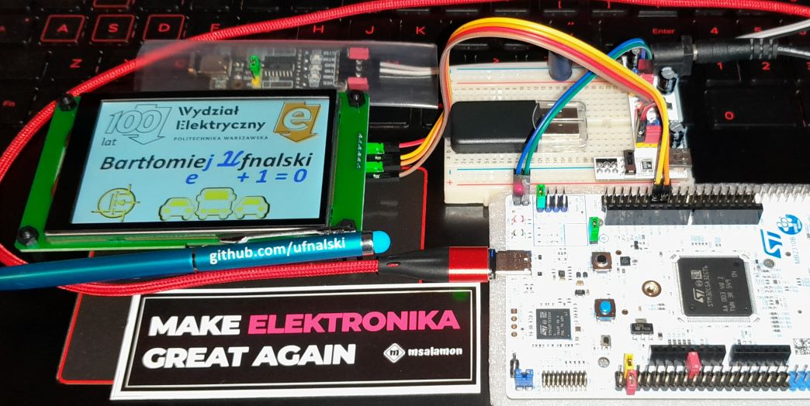
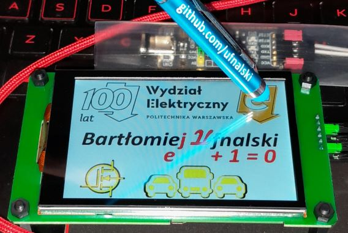

# DWIN/DGUS HMI capacitive touch screen demo [STM32C5A3ZG]

My very first step into the DWIN Graphic Utilized Software (DGUS) and an exemplary DWIN T5L HMI touch screen world ([DMG48320C035_03WTC](https://www.dwin-global.com/3-5-inch-smart-lcm-dmg48320c035_03wcommercial-grade-product/)).

# Missing files?
Don't worry. Just open the .ioc2 file in STM32CubeMX2 and hit the yellow button to generate the IDE project. Then open the project in STM32CubeIDE for Visual Studio Code and build it.

# Readings
* [T5L DGUS V7.6 Video Tutorial](https://www.dwin-global.com/t5l-dgus-v7-6-video-tutorial/) (DWIN)
* [SDKs and manuals](https://whiteelectronics.pl/content/6-do-pobrania) (White Electronics)
* [3.5 inch smart LCM DMG48320C035_03W (Commercial grade)](https://www.dwin-global.com/3-5-inch-smart-lcm-dmg48320c035_03wcommercial-grade-product/) (DWIN)
* [DMG48320C035_03WTC](https://www.tme.eu/en/details/dmg48320c035-03wtc/intelligent-displays-modules/dwin-technology/dmg48320c035-03wtc/)
* [DMG48320C035_03WTC Product Specification](https://www.tme.eu/Document/8170fdd3b3245625c365554a36ea0348/DMG48320C035_03WTC_Datasheet.pdf)
* [STM32 UART DMA + DWIN LCM tutorial](https://www.youtube.com/watch?v=kfD5VJCjMo0&list=PLC0m03UXrg1iLNEaiOUE2lSEG66q_fj4v) (Mikołaj Andrzejewski, Embedded Garage Polska)
* [stm32_dwin_dma](https://github.com/Embedded-Garage/stm32_dwin_dma) (Mikołaj Andrzejewski, Embedded-Garage, embeddedgaragepl, mikandrzej)

# Call to action
Create your own [home laboratory/workshop/garage](http://ufnalski.edu.pl/control_engineering_for_hobbyists/2026_festiwal_nauki/Festiwal_Nauki_2026.pdf)! Get inspired by [ControllersTech](https://www.youtube.com/@ControllersTech), [DroneBot Workshop](https://www.youtube.com/@Dronebotworkshop), [Andreas Spiess](https://www.youtube.com/@AndreasSpiess), [GreatScott!](https://www.youtube.com/@greatscottlab), [bitluni's lab](https://www.youtube.com/@bitluni), [ElectroBOOM](https://www.youtube.com/@ElectroBOOM), [Phil's Lab](https://www.youtube.com/@PhilsLab), [atomic14](https://www.youtube.com/@atomic14), [That Project](https://www.youtube.com/@ThatProject), [Paul McWhorter](https://www.youtube.com/@paulmcwhorter), [Max Imagination](https://www.youtube.com/@MaxImagination), [Nikodem Bartnik](https://www.youtube.com/@nikodembartnik), [Stuff Made Here](https://www.youtube.com/@StuffMadeHere), [Mario's Ideas](https://www.youtube.com/@marios_ideas), [Aaed Musa](https://www.aaedmusa.com/), [Haase Industries](https://www.youtube.com/@h1tec), [Marcin Plaza](https://www.youtube.com/MarcinPlaza), and many other professional hobbyists sharing their awesome projects and tutorials! Shout-out/kudos to all of them! Promote [README-driven learning](http://ufnalski.edu.pl/proceedings/sene2025/Ufnalski_PE_formatted_SENE_2025.pdf).

> [!WARNING]
> Commercial grade COB UART LCD modules - do try them at home :grey_exclamation:

230 challenges to start from: [Control Engineering for Hobbyists at the Warsaw University of Technology](http://ufnalski.edu.pl/control_engineering_for_hobbyists/Control_Engineering_for_Hobbyists_list_of_challenges.pdf).

Stay tuned!

0xBU
